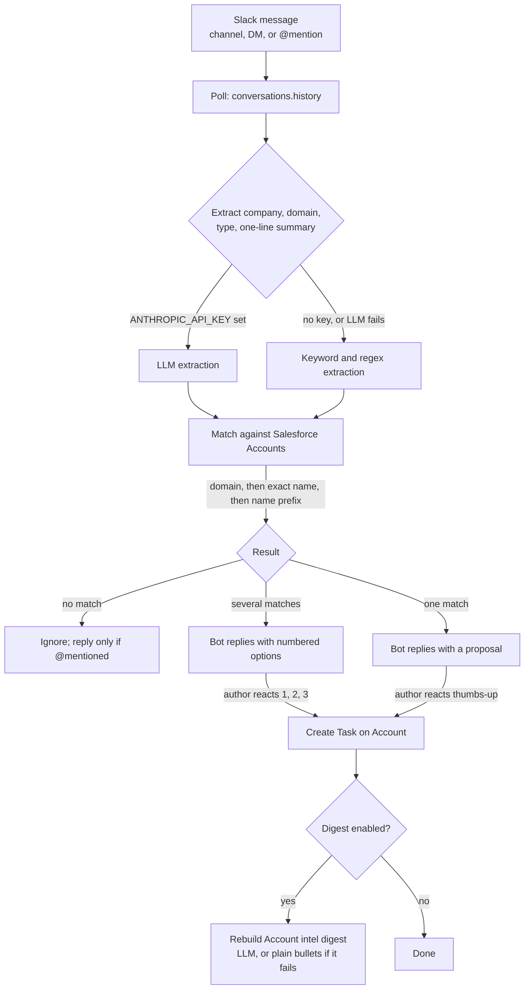

# slack-account-intel-bot

A Slack bot that turns account intel posted in Slack into Salesforce Tasks on the right Account.

Someone on the team writes "Acme is evaluating vendors, budget in Q3" in a sales channel, in a DM to the bot, or in a thread with an @mention. The bot works out which Salesforce Account that is, asks the author when it is not sure, and logs a Task on the Account with the author and a link back to the Slack message. Optionally, a model keeps a short rolling digest of recent intel in a field on the Account.

Python 3.10+, standard library only. No packages to install.

## The problem

Account intel is spread across Slack threads and DMs: who the champion is, which tool they run, when the contract renews, what stalled the deal. It is useful for exactly one conversation and then buried. The CRM, where the next rep will look, never sees it, because logging it takes several clicks and nobody does it.

This bot makes the cheap path the one that works: say it in Slack, react with a thumbs-up, and it is on the Account.

## How it works



The architecture is a poller, not a webhook receiver. It calls the Slack Web API on an interval, reads reactions on its own replies, and keeps a small JSON state file. There is no public endpoint to host and no listener to keep alive; it runs fine as a cron job (`--once`) or a small process.

What the bot reads:

- Channels listed in `channels` (passive: every message is considered).
- Any other channel it has been invited to (mention-only: it ignores everything except messages that @mention it).
- DMs to the bot (every message is considered, and nobody else sees it).

An @mention inside a thread uses the thread so far as the material, so "@bot log this" under a longer discussion works.

What a logged Task looks like:

| Task field | Value |
|---|---|
| Subject | `Intel: ` plus a one-line summary |
| Description | The message text, then who posted it, where, and the Slack permalink |
| WhatId | The matched Account |
| Type | `Intel` (configurable) |
| Status, ActivityDate | Completed, the message date |
| Optional | Owner, Contact (if a named person matches), record type, and custom fields for intel type, source link and logged-by |

## Account matching

In order, stopping at the first stage that finds something:

1. Domain. Email addresses and URLs in the message are compared with the Account's domain field.
2. Exact name, ignoring case, punctuation and suffixes like Inc and LLC.
3. Name prefix on a word boundary: "Acme" finds "Acme Robotics" but "Acm" finds nothing.

One hit is a match. Several hits are ambiguous: the bot posts the options and the author picks by reacting with a number. If you set `priority_field` (for example a target-account checkbox), a single priority account among several hits wins. In `auto` approval mode only domain and exact-name matches are logged without asking; a prefix match is always confirmed first.

## Quick start

No Slack or Salesforce needed:

```
python3 -m slack_account_intel --offline
python3 -m unittest discover -t . -s tests
```

`--offline` runs the fixture messages in `fixtures/` through extraction and matching against fake accounts, prints each Task it would create, and prints the digest prompt and the no-LLM digest. It makes no network calls.

Against a real workspace:

```
cp config.example.json config.json        # edit channels and field names
export SLACK_BOT_TOKEN=xoxb-...           # from your secrets manager
export ANTHROPIC_API_KEY=...              # optional
python3 -m slack_account_intel --config config.json --no-write --since 24
python3 -m slack_account_intel --config config.json --once
python3 -m slack_account_intel --config config.json            # loop every poll_interval_seconds
```

`--no-write` reads Slack and Salesforce but posts nothing, writes nothing and saves no state. It prints each Task payload it would create. Run it first.

## Slack app setup

1. Create an app from `slack/manifest.json` (api.slack.com/apps, "From a manifest"). The scopes are `channels:history`, `channels:read`, `channels:join`, `groups:history`, `groups:read`, `im:history`, `im:read`, `chat:write`, `users:read`. The Messages tab is enabled so people can DM the bot.
2. Install it to the workspace and copy the bot token into `SLACK_BOT_TOKEN`. Keep it in a secrets manager or your shell environment, not in `config.json`.
3. Put the channels to read in `channels`. The bot joins listed public channels itself. Invite it to private channels and to any channel where you want mention-only access.
4. Tell people the channel is being read. The bot reads every message in a listed channel.

Reactions are read from the bot's own messages, so no reaction scope is needed.

## Salesforce setup

Auth: the bot uses `SF_ACCESS_TOKEN` and `SF_INSTANCE_URL` if both are set. Otherwise it runs `sf org display --target-org <target_org> --json` and uses that session, refreshing it on a 401. The user needs to create Tasks and update the digest field.

Minimum, no custom fields:

- Add `Intel` as a value of the Task `Type` picklist (or change `task.type` to a value you already have).

Optional, all set in `config.json` and all off by default:

| Config key | What it is | Example (yours will differ) |
|---|---|---|
| `salesforce.domain_field` | Account field holding the website or domain | `Website` |
| `salesforce.name_fields` | Account fields compared on name | `["Name", "Alias__c"]` |
| `salesforce.priority_field` | Account checkbox used to break ties | `Is_Target__c` |
| `task.record_type_developer_name` | Task record type to use | `Intel` |
| `task.fields.intel_type` | Task text/picklist field for the intel category | `Intel_Type__c` |
| `task.fields.source_link` | Task URL field for the Slack permalink | `Source_Link__c` |
| `task.fields.logged_by` | Task text field for the poster | `Logged_By__c` |
| `task.owner_map` | Slack display name to Salesforce User Id | `{"Jordan Lee": "005..."}` |
| `digest.account_field` | Long text area (about 1,000 chars) on Account | `Intel_Digest__c` |
| `digest.last_date_field` | Date field on Account stamped on each update | `Last_Intel_Date__c` |

The source link and author are always in the Task description, so the custom Task fields are for reporting, not required.

For the digest, create the Account long text area, give the bot's Salesforce user edit access to it, and set `digest.enabled` to true.

## Intel digest

After a Task is logged, the bot loads the account's recent Tasks of the intel type (`lookback_days`, up to `max_items`), sends them with the current digest to the model, and writes the reply to `digest.account_field`, cut to `max_chars`.

The model is called through the Anthropic Messages API with `urllib` (`x-api-key` and `anthropic-version: 2023-06-01` headers). Set `ANTHROPIC_API_KEY` and, if you want, `llm.model` (default `claude-sonnet-5-5`). The prompt tells it to merge duplicates, drop contradicted facts and add nothing that is not in the entries. If the call fails, times out, or returns nothing, the digest is built without a model: the newest entries as bullets, trimmed to fit. A failed digest never undoes a logged Task.

## Design notes

- Polling over Socket Mode or Events API. Simpler to run and to reason about; the cost is latency of up to one poll interval, and no support for features that need an interactive endpoint.
- Approval by reaction. The bot proposes and a human confirms. Writing to a CRM on a guess is the failure to avoid, so `auto` mode is limited to domain and exact-name matches.
- The LLM is optional and never on the critical path. Extraction and digests have a deterministic fallback, so the bot keeps working when the API is down or no key is set. Matching is plain code, not a model call.
- Every Salesforce field name is configuration. The defaults need only the `Intel` Task type.
- One state file (`state.json`) tracks the last-read timestamp per channel, pending proposals and handled messages. Delete it to start fresh.
- Secrets are read from environment variables only.

## Limitations

- No Slack message shortcut or slash command. Those need an HTTP or Socket Mode endpoint, which this design avoids. Use the @mention or a DM instead.
- Without an LLM, extraction is keyword-based. It finds capitalized names and domains, so it misses lowercase company names and can propose a wrong account for a common word (it always asks first, except on domain or exact-name matches in `auto` mode). Expect better results with an API key.
- Name matching is literal. "Acme Corp" and "ACME Robotics Group" are different to it.
- Text only. Screenshots, PDFs and files are not read.
- Forwarded messages and pasted permalinks are not expanded; the bot sees the text you send.
- No edit-in-place correction. React with an X and post again.
- Single process, single workspace, not tested at high message volume. The Slack and Salesforce clients are small and have not been exercised against every API edge case; run `--no-write` first.
- The tests cover matching, extraction, payload building and digest logic. The live Slack and Salesforce paths are not covered by automated tests.

## Layout

```
slack_account_intel/   package: config, extract, matching, pipeline, tasks, digest, llm, clients, bot, cli
fixtures/              fake accounts, messages and intel Tasks for --offline and tests
slack/manifest.json    Slack app manifest
tests/                 unittest, no network
config.example.json    every setting, with defaults
```

## License

MIT. See `LICENSE`.
